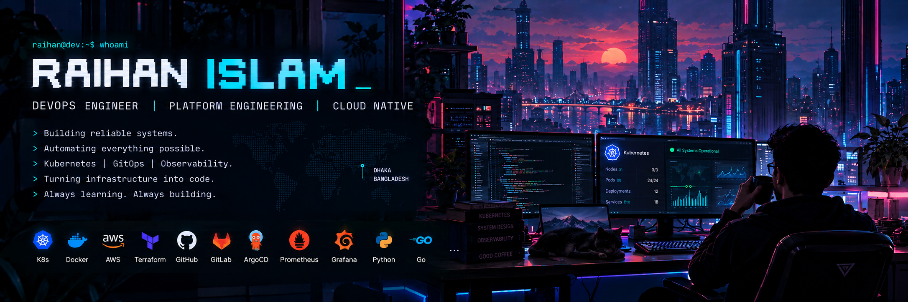

 

  

<!--  -->

### `$ tech --stack`

 

 

### `$ git log --streak`

<picture>
  <source media="(prefers-color-scheme: dark)" srcset="https://raw.githubusercontent.com/Raihan-009/Raihan-009/output/github-snake-dark.svg"/>
  
</picture>

